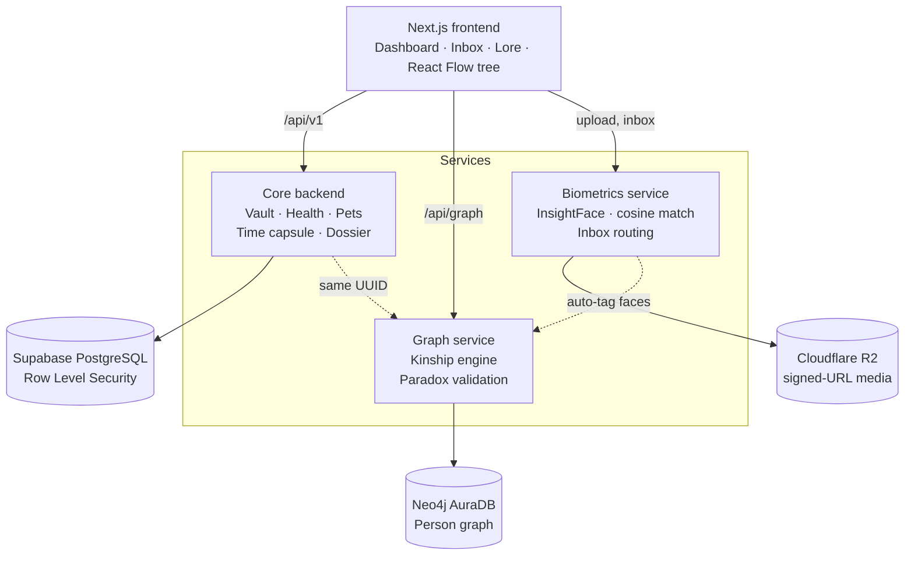
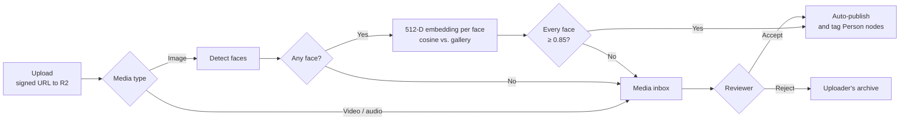
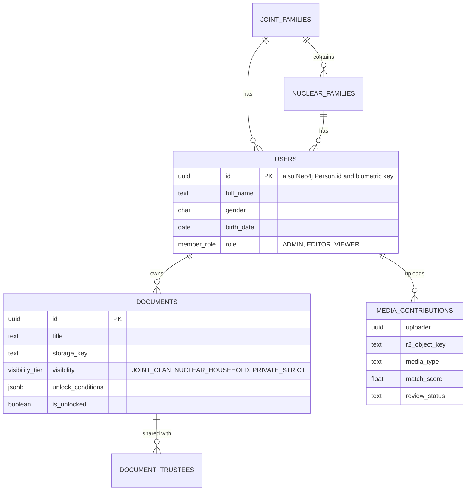

<div align="center">

# FamilyVault

**A private, multi-tenant platform for keeping a family's documents, health records, relationships and memories, with access that follows how families actually trust each other.**


[Why](#why) · [Features](#features) · [Architecture](#architecture) · [Getting started](#getting-started) · [API](#api) · [Security](#security-model) · [Testing](#testing) · [Limitations](#limitations) · [Roadmap](#roadmap)

</div>

---

## Why

In many Indian households the family is a **joint clan**: several nuclear families linked across three or more generations by shared ancestry, property and tradition. Over decades it accumulates deeds, medical histories, pet vaccination records, photographs, voice recordings and stories. These end up in almirahs, personal phones and WhatsApp groups, which makes them hard to find, easy to lose and impossible to share selectively.

FamilyVault is a web app built for that structure. The interesting problems are not the CRUD screens but these four:

- **Tenant isolation across two databases.** PostgreSQL is protected by Row Level Security; Neo4j has no equivalent, so graph queries are scoped and tested explicitly.
- **Kinship that sounds right.** Titles like *Chacha, Tauji, Mama, Bua, Masi* are computed from graph paths, not stored as labels.
- **One identity everywhere.** A single UUID is the user ID, the graph node ID and the biometric key.
- **Biometrics with a human in the loop.** Face matching only auto-publishes when every face clears a conservative threshold; everything else waits for a person.

---

## Features

### Three-tier privacy vault

Documents, property papers, pet records and health records carry a visibility tier, enforced in the database.

| Tier | Visible to | Typical content |
|---|---|---|
| `JOINT_CLAN` | Every household in the clan | Ancestral deeds, family tree, shared lore |
| `NUCLEAR_HOUSEHOLD` | The owning household only | Financial records, private medical documents |
| `PRIVATE_STRICT` | The creator and chosen trustees | Personal letters, highly sensitive records |

### Kinship graph

Each member is a `(:Person)` node in Neo4j connected by `PARENT_OF` and `SPOUSE_OF`. To name a relationship, the graph service finds the shortest path between two people and converts the hops, together with gender, birth order and which side of the family the path runs through, into a title.

| Path from you | Title | Side |
|---|---|---|
| up to a male parent | Papa | Paternal |
| up to a female parent | Mummy | Maternal |
| up, up, down to father's elder brother | Tauji | Paternal |
| up, up, down to father's younger brother | Chacha | Paternal |
| up, up, down to father's sister | Bua | Paternal |
| up, up, down to mother's brother | Mama | Maternal |
| up, up, down to mother's sister | Masi | Maternal |

```
You ─UP→ Papa ─UP→ Dada ─DOWN→ Uncle
hops       = (UP, UP, DOWN)           sibling of a parent
via parent = male                     father's side
target     = male, born after Papa    → Chacha
```

**Paradox guard.** Before a parent link is written, a validation query rejects a person who is their own parent, a child who is not younger than the parent, and any link that would make someone their own ancestor.

### Biometric media pipeline

1. The browser uploads to Cloudflare R2 through a short-lived signed URL.
2. InsightFace detects every face and produces a 512-D, L2-normalised embedding for each.
3. Each embedding is compared to the family gallery by cosine similarity against a single constant, `MATCH_THRESHOLD = 0.85`.
4. Routing is deliberately conservative:

| Situation | Outcome |
|---|---|
| Image where every face scores ≥ 0.85 | Auto-published and linked to the matching `Person` nodes |
| Any face below the threshold | Media inbox |
| Image with no detectable face | Media inbox |
| Any video or audio | Media inbox (always human-reviewed) |
| Rejected item | Kept in the uploader's own archive, never deleted |

### Time capsule

Attach `unlock_conditions` to a document: a future timestamp, or a trustee-verified approval. Until the conditions are met, only the owner can see it.

```json
{ "not_before": "2044-05-01T00:00:00Z" }
```

### Emergency dossier

One call compiles blood group, allergies, vital prescriptions and emergency contacts into a single summary for hospital staff or distant caregivers. It runs under the caller's JWT, so RLS still applies.

### Interface

- **Tree canvas** built on React Flow: pan, zoom, search, custom nodes, and kinship path highlighting between any two people.
- **Person drawer** with photos, health alerts, unlocked letters and the kinship badge.
- **Media inbox** with accept/reject and confidence-score previews.
- **Household dashboard** with records, health reminders and pet vaccination timelines.
- **Lore timeline** of images, audio and video memories.
- Responsive layout with five top-level sections (Tree, Vault, Health, Media Inbox, Lore) kept simple for older relatives.

---

## Screenshots

| Login | Dashboard |
|:---:|:---:|
|  |  |
| **Family tree** | **Household vault** |
|  |  |
| **Media inbox** | **Emergency dossier** |
|  |  |

---

## Architecture

Three independent FastAPI services behind one Next.js frontend, over a polyglot data layer.



### Design decisions

| Decision | Reasoning |
|---|---|
| **PostgreSQL + Neo4j** | Kinship is a graph problem: shortest path is a short Cypher query but awkward recursive SQL. Records, permissions and tenancy stay in PostgreSQL where RLS protects them. |
| **Separate services** | Graph and biometrics can be developed, tested and scaled independently. Biometrics is the heavy one (CPU inference). |
| **One UUID** | Generated once in `users.id`, reused as Neo4j `Person.id` and as the biometric key. IDs generated independently per store drift apart; this removes that class of bug, and a cross-database check flags orphans. |
| **Contracts first** | `/contracts` holds the SQL schema, mock responses and shared constants, so the frontend can build against mocks before a service exists. |
| **Signed URLs only** | Media is never public. Every upload and download uses a short-lived signed URL. |
| **Explicit graph scoping** | RLS does not cover Neo4j, so every graph query carries the clan ID and is tested separately. |
| **One threshold, one file** | `MATCH_THRESHOLD` lives in `contracts/MATCH_CONSTANTS.json` and is imported by both the service and the tests. A conservative value favours asking a human over silently mis-tagging a relative. |

### Biometric decision flow



---

## Tech stack

| Layer | Technology |
|---|---|
| Frontend | Next.js (App Router), Tailwind CSS, shadcn/ui, `@xyflow/react` |
| Services | Python, FastAPI (core, graph, biometrics) |
| Relational | Supabase PostgreSQL with Row Level Security |
| Graph | Neo4j AuraDB, Cypher |
| Biometrics | InsightFace, NumPy |
| Storage | Cloudflare R2 |
| Testing | Pytest, Postman, Playwright |
| Hosting | Vercel (frontend), Render or Railway (services) |

---

## Repository structure

```
familyvault/
├── frontend/          Next.js app: dashboard, tree canvas, inbox, lore
├── backend/           Core service: vault, health, will, dossier
│   └── scripts/seed.py    Recreates the 10-user, 3-generation dataset
├── graph-service/     Kinship engine, paradox guard, /api/graph/tree
├── biometrics/        Embeddings, cosine matching, inbox routing
├── contracts/         schema.sql, mock responses, MATCH_CONSTANTS.json
├── tests/             CRUD, RLS, penetration and biometric boundary tests
└── docs/              Screenshots and assets
```

---

## Getting started

### Prerequisites

- Node.js 18+
- Python 3.10+
- A Supabase project, a Neo4j AuraDB instance (free tier is fine) and a Cloudflare R2 bucket with an API token
- 8 GB RAM minimum, 16 GB recommended (InsightFace runs on CPU)

### 1. Clone

```bash
git clone https://github.com/<your-username>/familyvault.git
cd familyvault
```

### 2. Configure environment

Create a `.env` in `backend/`, `graph-service/` and `biometrics/`. These files are git-ignored; never commit credentials.

```env
# Supabase / PostgreSQL
SUPABASE_URL=https://<project>.supabase.co
SUPABASE_ANON_KEY=<anon-key>
SUPABASE_SERVICE_ROLE_KEY=<service-role-key>
DATABASE_URL=postgresql://<user>:<password>@<host>:5432/postgres

# Neo4j AuraDB
NEO4J_URI=neo4j+s://<instance>.databases.neo4j.io
NEO4J_USER=neo4j
NEO4J_PASSWORD=<password>

# Cloudflare R2
R2_ACCOUNT_ID=<account-id>
R2_ACCESS_KEY_ID=<access-key>
R2_SECRET_ACCESS_KEY=<secret-key>
R2_BUCKET=<bucket-name>
```

And `frontend/.env.local`:

```env
# "true" reads mock JSON from /contracts, "false" calls the live API
NEXT_PUBLIC_USE_MOCK=true
NEXT_PUBLIC_GRAPH_API=http://localhost:8001
```

### 3. Provision the databases

```bash
psql "$DATABASE_URL" -f contracts/schema.sql
```

```cypher
CREATE CONSTRAINT person_id_unique IF NOT EXISTS
FOR (p:Person) REQUIRE p.id IS UNIQUE;
```

### 4. Run the services

```bash
# Core backend
cd backend && pip install -r requirements.txt
uvicorn main:app --reload --port 8000

# Graph service
cd graph-service && pip install -r requirements.txt
uvicorn main:app --reload --port 8001

# Biometrics service
cd biometrics && pip install -r requirements.txt
uvicorn main:app --reload --port 8002
```

### 5. Seed demo data

```bash
python backend/scripts/seed.py
```

This creates ten users across three generations in both PostgreSQL and Neo4j with identical UUIDs, and can be re-run to reset to a clean state.

### 6. Start the frontend

```bash
cd frontend && npm install && npm run dev
```

Open http://localhost:3000. To work on the UI without the graph service, leave `NEXT_PUBLIC_USE_MOCK=true`.

<details>
<summary>Troubleshooting</summary>

| Symptom | Likely cause |
|---|---|
| Tree is empty | Mock mode is off but the graph service is down, or the seed script has not run |
| Another household's records appear | RLS is not enabled on a table; re-apply `contracts/schema.sql` |
| Orphan users in the identity check | `users.id` and `Person.id` diverged; re-run the seed script and never generate IDs in Neo4j |
| First face detection is slow | InsightFace downloads model weights on first run |
| Everything lands in the inbox | The gallery has no reference embeddings yet, or scores are under 0.85 |
| Neo4j connection refused | Use the `neo4j+s://` URI from AuraDB and confirm the instance is running |

</details>

---

## API

### Core backend (`:8000`)

| Method | Endpoint | Description |
|---|---|---|
| `POST` | `/api/v1/health/emergency-dossier/{user_id}` | Compile the emergency dossier (RLS applies) |
| `*` | `/api/v1/...` | CRUD for documents, property, pets, health records and time-capsule items |

### Graph service (`:8001`)

| Method | Endpoint | Description |
|---|---|---|
| `GET` | `/api/graph/tree` | Family tree with a kinship badge for every member |

### Biometrics service (`:8002`)

Signed upload URLs for image, video and audio; face detection and matching at `MATCH_THRESHOLD`; inbox accept and reject.

<details>
<summary>Example: emergency dossier</summary>

```bash
curl -X POST http://localhost:8000/api/v1/health/emergency-dossier/<user_id> \
     -H "Authorization: Bearer <jwt>"
```

```json
{
  "full_name": "Eleanor Vance",
  "blood_group": "A+",
  "allergies": ["Penicillin", "Sulfa Drugs"],
  "vital_prescriptions": [],
  "emergency_contacts": []
}
```

</details>

<details>
<summary>Example: media routing result</summary>

```python
route_media(media_type, image_bgr, gallery)
# ("AUTO_PUBLISH", [{"person_id": "<uuid>", "score": 0.912}, ...])
# ("INBOX", [])
```

</details>

---

## Data model



<details>
<summary>Row Level Security policy for documents</summary>

```sql
CREATE POLICY documents_select ON documents FOR SELECT USING (
  (is_unlocked OR owner_id = auth.uid())
  AND (
       (visibility = 'JOINT_CLAN'        AND joint_family_id   = current_joint_family())
    OR (visibility = 'NUCLEAR_HOUSEHOLD' AND nuclear_family_id = current_nuclear_family())
    OR (visibility = 'PRIVATE_STRICT'    AND (owner_id = auth.uid()
         OR EXISTS (SELECT 1 FROM document_trustees t
                    WHERE t.document_id = documents.id AND t.trustee_id = auth.uid())))
  )
);
```

</details>

<details>
<summary>Neo4j paradox guard and tenant-scoped path query</summary>

```cypher
// Returns a row only if the edge would be impossible
MATCH (p:Person {id: $parent_id}), (c:Person {id: $child_id})
WHERE p.id = c.id                              // self-parenting
   OR c.birth_date <= p.birth_date             // child not younger than parent
   OR EXISTS { (c)-[:PARENT_OF*1..]->(p) }     // cyclic ancestry
RETURN p.id AS parent_id, c.id AS child_id;

// Shortest relationship path, scoped to one clan
MATCH (a:Person {id: $from_id, joint_family_id: $jf}),
      (b:Person {id: $to_id,   joint_family_id: $jf})
MATCH path = shortestPath((a)-[:PARENT_OF|SPOUSE_OF*..12]-(b))
RETURN [n IN nodes(path) | {id: n.id, gender: n.gender, birth_year: n.birth_year}] AS people,
       [r IN relationships(path) | type(r)] AS rel_types;
```

</details>

---

## Security model

- **Row Level Security** on every tenant table, so a valid session token can never read another tenant's rows.
- **Tenant-scoped Neo4j queries**, since RLS does not protect the graph database.
- **Short-lived signed URLs** for all media access.
- **No secrets in Git.** Credentials live in `.env` and `.env.local`.
- **Human approval** for every uncertain biometric match. Rejected media is retained, not destroyed.
- **Single `MATCH_THRESHOLD`** in exactly one file.
- **Handled errors** on API failures rather than unhandled exceptions.

> **Note on sensitive data.** Biometric and health data are sensitive personal data. If you deploy this for real people, handle it in line with applicable law (for example India's DPDP Act, 2023) and get informed consent from everyone whose face or records are stored.

---

## Testing

```bash
pytest tests/             # CRUD, RLS, penetration and biometric boundary tests
npx playwright test       # end-to-end
```

| ID | What is verified | Expected result |
|---|---|---|
| V1 | PostgreSQL tenant isolation (cross-tenant token test) | Another tenant's rows are never returned |
| V2 | Neo4j tenant isolation (cross-clan graph query) | No foreign nodes returned |
| V3 | Visibility tiers (clan member, household member, non-owner, trustee) | Each tier behaves as specified |
| V4 | Kinship correctness on two or more test families | Correct titles (Chacha, Mama, ...) |
| V5 | Paradox validation (child older than parent, cycles) | Both rejected |
| V6 | Embedding size | 512-D vector produced |
| V7 | Threshold boundary | 0.849 goes to inbox; 0.850 can auto-publish |
| V8 | Biometric edge cases (group photo, no face, rejected media) | All faces handled; no-face goes to inbox; rejected stays in the uploader's archive |
| V9 | Identity consistency across stores | Every `users.id` has a matching `Person.id` |
| V10 | Responsive UI | No layout breakage on a mobile viewport; loading states shown |

---

## Limitations

- **Scale.** Developed and tested with ten seeded users across three generations. Large clans are not validated.
- **Kinship coverage.** Covers a core set of North Indian terms. Other regional vocabularies, and step, half and in-law relations, need more rules.
- **Biometrics.** Accuracy depends on image quality, pose and lighting, and can degrade for children as they age or for partially visible faces. CPU-only inference limits throughput.
- **Split isolation.** RLS covers PostgreSQL only; Neo4j isolation depends on scoped queries and tests.
- **Prototype maturity.** Some features are prototype-level rather than production-hardened.
- **Platform.** Responsive web app only; no native mobile app.

---

## Roadmap

- [ ] Installable app with offline access to the emergency dossier
- [ ] Hindi and other Indian languages
- [ ] Regional kinship titles; step, half and in-law relations
- [ ] End-to-end encryption for `PRIVATE_STRICT`; consent and audit log for biometrics
- [ ] Liveness checks, periodic embedding refresh as children grow, audio transcription
- [ ] OCR, auto-classification and renewal reminders for documents
- [ ] Unlock notifications and a guided trustee-verification flow
- [ ] Observability, rate limiting, automated backups, load testing for larger clans

---

## Contributing

Issues and pull requests are welcome. Branch from `develop` as `feature/<name>` or `fix/<name>`, use [Conventional Commits](https://www.conventionalcommits.org), and open a PR that says which contract it affects. Changes touching authentication, RLS or biometric matching get an extra review. Never commit secrets, and keep `MATCH_THRESHOLD` in one place.

## References

- Deng, Guo, Xue, Zafeiriou (2019). *ArcFace: Additive Angular Margin Loss for Deep Face Recognition.* CVPR.
- Robinson, Webber, Eifrem (2015). *Graph Databases*, 2nd ed. O'Reilly.
- Government of India (2023). *The Digital Personal Data Protection Act, 2023.*

## License

MIT. See [LICENSE](LICENSE).
