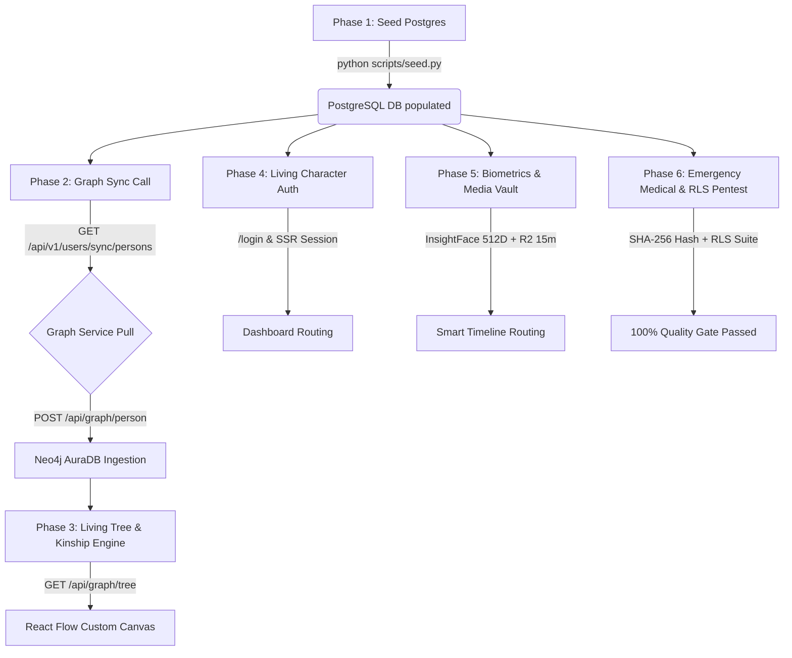

# FamilyVault — Sprint 3 End-to-End Master Workflow

**Document Version**: 3.2.0  
**Status**: Active Production Standard  
**Lead Architect**: Runeet (`realruneett01`)  
**Target Branch**: `develop`  
**Services Covered**: Next.js Frontend (1111/3000), Core Backend (8000), Graph Service (8001), Biometrics Engine (8002), Postgres (54322), Neo4j AuraDB  

---

## 1. Executive Summary & Evolution Context

Sprint 3 transitions FamilyVault from isolated microservice prototypes (Sprint 1 & 2) into a unified, reactive, production-grade Generational Operating System. 

```
+---------------------------------------------------------------------------------------------------+
|                                     FAMILYVAULT SPRINT 3 TOPOLOGY                                 |
+---------------------------------------------------------------------------------------------------+
|                                                                                                   |
|    [ Next.js 16.2.6 Frontend ] (:1111)                                                            |
|       * Living Character Auth (/login) <--- Auto-redirect from /                                  |
|       * Living Tree Canvas (/dashboard/family) <--- React Flow Nodes                              |
|       * Nuclear Family Dashboard (/dashboard/nuclear-family)                                     |
|              |                                        |                                           |
|              v                                        v                                           |
|    [ FastAPI Core Backend ] (:8000)        [ Neo4j Graph Service ] (:8001)                        |
|       * Vault & Milestone Documents           * /api/graph/tree (Nodes & Edges)                   |
|       * Household Members & Pets              * /api/graph/kinship (Chacha/Mama)                  |
|       * Emergency Medical Dossier (SHA-256)   * Cypher Shortest Path Engine                       |
|       * Graph Sync API (/users/sync/persons)         ^                                            |
|              |                                       |                                            |
|              | (X-API-Key Service Pull)              | (Cypher Ingest)                            |
|              +---------------------------------------+                                            |
|              |                                                                                    |
|              v                                        v                                           |
|    [ PostgreSQL 15 / Supabase ]             [ Neo4j AuraDB Enterprise ]                           |
|       * Vance Clan 10-UUID Seed                * Person Nodes & Familial Edges                    |
|       * Multi-Tier RLS Security (Ayush Pentest)                                                   |
|                                                                                                   |
|    [ Biometrics Microservice ] (:8002)                                                            |
|       * InsightFace 512D Embeddings                                                               |
|       * 15-Minute R2 Presigned Uploads                                                            |
|       * Smart Routing: Timeline (>=0.85) vs. Inbox (<0.85)                                        |
+---------------------------------------------------------------------------------------------------+
```

### Key Milestones Achieved in Latest Repository (`develop`):
1. **Living Character Interactive Authentication Suite**: Saccadic eye tracking with quintic ease-out curves (`cubic-bezier(0.22, 1, 0.36, 1)`), pointer hover-triggered mutual gaze between Purple and Black on Password, attentive forward lean on Email, and dynamic Orange head tilt/shake.
2. **PG <-> Neo4j Graph Sync & Service Auth**: Restored `gender`, `clan_id`, `clan_name`, and `generation` on household endpoints. Added dedicated sync endpoint `GET /api/v1/users/sync/clan/{clan_id}/persons` authenticated via `X-API-Key: service-role-key-placeholder`.
3. **Living Tree Canvas Rebuild**: `/api/graph/tree` contract rebuilt to React Flow nodes/edges with duplicate-edge deduplication, lazy-write resolution, and custom React Flow nodes for Head, Ancestor, and Living Members with fallback support.
4. **Biometric Smart Routing & Expiration**: Presigned R2 URLs tightened to 15-minute expiration window; smart image vs non-image routing and 0.85 cosine similarity timeline matching.
5. **Security & Medical Dossier**: SHA-256 tamper-proof emergency dossier compilation (`POST /api/v1/health/emergency-dossier/{user_id}`) and automated RLS penetration test suite verifying zero data leaks across household tiers.

---

## 2. Canonical Data Model: The Vance Clan 3-Generation Benchmark

All 4 services and testing suites align on a deterministic 10-person multi-generation benchmark established in `backend/scripts/seed.py` and `contracts/graph-tree-response.json`:

| Generation | Persona | Role | Relation to Head | Gender | DOB | Deterministic UUID |
| :---: | :--- | :---: | :---: | :---: | :---: | :---: |
| **Gen 1** | **Arthur Vance** | ADMIN | HEAD | `male` | `1948-03-15` | `00000000-0000-0000-0000-000000000001` |
| **Gen 1** | **Eleanor Vance** | ADMIN | SPOUSE | `female` | `1952-08-22` | `00000000-0000-0000-0000-000000000002` |
| **Gen 2** | **David Vance** | MEMBER | CHILD | `male` | `1975-11-10` | `00000000-0000-0000-0000-000000000003` |
| **Gen 2** | **Sarah Vance** | MEMBER | SPOUSE | `female` | `1978-05-18` | `00000000-0000-0000-0000-000000000004` |
| **Gen 2** | **Michael Vance** | MEMBER | CHILD | `male` | `1980-02-14` | `00000000-0000-0000-0000-000000000005` |
| **Gen 2** | **Clara Vance** | MEMBER | SPOUSE | `female` | `1982-09-30` | `00000000-0000-0000-0000-000000000006` |
| **Gen 2** | **Robert Vance** | MEMBER | CHILD | `male` | `1985-07-04` | `00000000-0000-0000-0000-000000000007` |
| **Gen 3** | **Lucas Vance** | CHILD | EXTENDED | `male` | `2005-06-12` | `00000000-0000-0000-0000-000000000008` |
| **Gen 3** | **Sophia Vance** | CHILD | EXTENDED | `female` | `2008-11-20` | `00000000-0000-0000-0000-000000000009` |
| **Gen 3** | **Emma Vance** | VIEWER | EXTENDED | `female` | `2012-01-08` | `00000000-0000-0000-0000-000000000010` |

*Clan Identification*: `clan_id: 11111111-1111-1111-1111-111111111111` ("Vance Ancestral Clan")  
*Households*: `nuclear_a: 22222222-2222-2222-2222-222222222222`, `nuclear_b: 33333333-3333-3333-3333-333333333333`

---

## 3. End-to-End Workflow Phases



### Phase 1: Canonical Database Seeding
1. **Operator Command**:
   ```bash
   cd backend
   python scripts/seed.py
   ```
2. **Operations Executed**:
   - Cleans all stale tenant data (idempotent execution).
   - Inserts `JointFamily` (Vance Ancestral Clan) and two `NuclearFamily` records.
   - Seeds all 10 Personas with exact deterministic UUID constants and DOBs.
   - Seeds 10 `FamilyMembership` relationships with multi-tier roles (`ADMIN`, `MEMBER`, `CHILD`, `VIEWER`).
   - Seeds Eleanor's Emergency Medical Profile (pacemaker, allergies, AIIMS contact) and Arthur's health profile.
   - Seeds household pets (`Barnaby` Golden Retriever, `Whiskers` Persian Cat).
   - Seeds milestone-locked vault documents with unlock conditions.

---

### Phase 2: Postgres <-> Neo4j Graph Synchronization
1. **Graph Service Pull Trigger**:
   - `graph-service` reads upstream URL from `BACKEND_API_URL` (`http://localhost:8000`).
   - Script requests person data from Core Backend using Service-Role authentication:
     ```http
     GET /api/v1/users/sync/clan/11111111-1111-1111-1111-111111111111/persons HTTP/1.1
     Host: localhost:8000
     X-API-Key: service-role-key-placeholder
     ```
2. **Payload Delivery**:
   - Backend returns `ClanPersonSyncResponse[]` with:
     - `person_id` (Postgres UUID)
     - `full_name`, `role`, `relation_to_head`
     - `generation` (1, 2, or 3)
     - `gender` (`"male"` or `"female"`)
     - `birth_date` (`YYYY-MM-DD`)
     - `nuclear_household` ("Patriarchal Household", "Nuclear Household A", "Nuclear Household B", "Extended Household")
     - `clan_id`, `clan_name`
3. **Neo4j Node & Relationship Insertion**:
   - Graph service upserts each record into Neo4j AuraDB via `MERGE (p:Person {id: $person_id})`.
   - Graph service executes `relationships.cypher` to link spouses (`MARRIED_TO`) and generations (`PARENT_OF`).
4. **Verification Gate**:
   - Running `backend/tests/test_uuid_parity.py` asserts 100% ID parity between Postgres and Neo4j.

---

### Phase 3: Living Tree & Kinship Visualization
1. **Live Tree Fetching**:
   - Frontend component `frontend/components/family/family-explorer.tsx` requests `GET http://localhost:8001/api/graph/tree`.
   - Rebuilt tree endpoint provides:
     - Deduplicated edges (`e_arthur_eleanor_spouse`, `e_arthur_david_child`, etc.).
     - Structured node data with layout positions.
     - Fallback to `contracts/graph-tree-response.json` if graph-service is offline.
2. **Custom React Flow Rendering**:
   - **Head Node**: Arthur Vance highlighted with Patriarch badge and golden accent border.
   - **Ancestor Node**: Eleanor Vance with generational matriarch tag.
   - **Living Members**: Custom generational cards with age badges, kinship relation pills, and direct medical indicator badges.
3. **Kinship Engine Traversal**:
   - Selecting two nodes calls `GET /api/graph/kinship/{from_id}/{to_id}`.
   - Example traversal: `Robert Vance` -> `Lucas Vance` evaluates:
     - Robert is sibling of David (Lucas's father).
     - Robert's gender is `male`.
     - Output: `"Chacha" (Paternal Uncle)`.

---

### Phase 4: Living Character Interactive Authentication
1. **Routing & Access**:
   - Opening `http://localhost:1111/` issues a `307 Temporary Redirect` straight to `/login`.
2. **Saccadic Physics & Responsive Eye Tracking**:
   - Cursor movement across the viewport calculates normalized vector coordinates `(pupil.x, pupil.y)`.
   - Pupil transforms apply a custom quintic ease-out curve (`cubic-bezier(0.22, 1, 0.36, 1)`) with a 200ms duration, preventing synthetic mechanical snapping.
3. **Pointer Hover Triggers**:
   - **Password Field Hover**: Purple curves organically into the banana arc (`d=purpleBananaPath`), locking mutual gaze with Black (`(209.2, 118.2)` down-right <-> `(220.8, 194.8)` up-left), while Orange watches with curious dots.
   - **Email Field Hover**: Purple executes a `9.3°` forward lean, focusing all characters attentively on the login card.
   - **Free Cursor Pursuit**: Orange dome dynamically wobbles and tilts (`rotate: pupil.x * 5.5deg`) with organic squash/stretch (`scaleX: 1 - |x|*0.035`), maintaining a sweet, cheerful upward smile (`◡`).
4. **Keystroke Feedback**:
   - Correct input prefix triggers delighted smile expansions.
   - Invalid input or submit failure triggers sad downturned frowns and a 3-cycle Orange head shake.
5. **Session Initiation**:
   - Valid submit routes to `/dashboard` via Supabase SSR session middleware.

---

### Phase 5: Biometric Smart Routing & Media Vault
1. **Presigned Upload Pipeline**:
   - Client requests upload URL -> Backend generates Cloudflare R2 presigned URL with a **strict 15-minute expiration** window.
2. **InsightFace 512D Embedding Generation**:
   - Biometrics worker processes image buffer with RetinaFace + ArcFace.
   - Multi-face detection extracts 512-dimensional normalized float vectors for every face in the photo.
3. **Smart Threshold Routing**:
   - Cosine distance computed against known member face banks:
     - **Match Score >= 0.85**: Image is tagged with member UUID and auto-routed to the person's **Milestone Timeline**.
     - **Match Score < 0.85**: Image routed to **Unassigned Inbox** for household head manual triage.
   - Non-image files (PDF, audio, DOCX) bypass face detection and route straight to Vault Category storage.

---

### Phase 6: Emergency Medical Dossier & Security Hardening
1. **Emergency Medical Dossier API**:
   - Endpoint: `POST /api/v1/health/emergency-dossier/{user_id}`
   - Compiles Eleanor's emergency profile in under 50ms:
     - Blood group (`O+`)
     - Allergies (`Penicillin`, `Sulfa drugs`)
     - Chronic conditions (`Hypertension`, `Arrhythmia`)
     - Emergency notes (`Cardiac pacemaker installed Nov 2024`)
     - SHA-256 tamper-proof verification hash computed over payload.
2. **Row-Level Security (RLS) Penetration Test**:
   - Test suite: `python tests/test_rls_policies.py`
   - Validates that `PRIVATE_STRICT` records (e.g. Eleanor's full psychiatric history) are never leaked to non-admin household members or unauthorized tenants.

---

## 4. Master Chronological Deliverables Sequence by Owner (Deliverable-after-Deliverable)

Each deliverable in Sprint 3 strictly depends on the completion of the preceding deliverable. Below is the exact execution chain showing **who delivers what, after whose work is completed**:

### Track A: Relational Foundation, Graph Ingestion & Living Lineage Tree
| Deliverable & Owner | Preceding Work (Must Be Done First) | Scope & Technical Work Executed | Output Artifact / Delivered Contract | Next Owner & Work Triggered | Status |
| :--- | :--- | :--- | :--- | :--- | :--- |
| **Deliverable 1**<br>**Runeet**<br>*(Lead Architect / Core Backend)* | Initial Postgres schema & DB migrations. | Authors deterministic seed script populating 10 Vance Clan personas across 3 generations, assigning joint family ID and relationships. | `backend/scripts/seed.py`<br>Populated Postgres DB with 10 deterministic UUIDs. | **Runeet** (Core Backend)<br>Triggered to build Graph Sync API. | **DONE**<br>Pushed to `develop` |
| **Deliverable 2**<br>**Runeet**<br>*(Core Backend)* | **Deliverable 1**<br>(Seeded Postgres DB with Vance clan). | Surfaces `gender`, `clan_id`, `clan_name`, `generation`, and service-role auth on sync endpoints mapping 1:1 to Riya's `PersonIn` schema. | `GET /api/v1/users/sync/persons`<br>Header: `X-API-Key`<br>Commit `bfe5f9d`. | **Riya** (Graph Service)<br>Triggered to write Neo4j pull ingestion script. | **HANDOFF READY**<br>Tests 11/11 pass |
| **Deliverable 3**<br>**Riya**<br>*(Graph Service Lead)* | **Deliverable 2**<br>(Runeet's sync API with service-role auth). | Builds pull sync script in `graph-service`, queries Runeet's API with `X-API-Key`, and upserts all 10 Person nodes and familial edges into Neo4j AuraDB. | `graph-service/pull_sync.py`<br>Neo4j AuraDB instance with 100% UUID parity. | **Riya** (Graph Service)<br>Triggered to author Kinship traversal engine. | **IN PROGRESS**<br>Riya pulling data |
| **Deliverable 4**<br>**Riya**<br>*(Graph Service Lead)* | **Deliverable 3**<br>(Populated Neo4j AuraDB graph). | Implements Cypher shortest-path algorithms to deduce complex kinship (Chacha, Mama, Bua, Masi); rebuilds and publishes `/api/graph/tree`. | `GET :8001/api/graph/tree`<br>`GET :8001/api/graph/kinship`<br>Schema: `graph-tree-response.json` | **Anushka** (Tree Frontend)<br>Triggered to wire React Flow tree canvas. | **IN PROGRESS**<br>Tree draft ready |
| **Deliverable 5**<br>**Anushka**<br>*(Tree Frontend Engineer)* | **Deliverable 4**<br>(Riya's live published tree endpoint). | Connects `family-explorer.tsx` to live `:8001/api/graph/tree`, rendering custom SVG nodes (Head, Ancestor, Living), generation tiers, and click-to-highlight kin paths. | `family-explorer.tsx`<br>Interactive React Flow tree canvas with zero mock data. | **Ayush** (Security Engineer)<br>Triggered for Lineage UI RLS access audit. | **READY TO WIRE**<br>Scaffold ready |

```
[D1: Runeet (Seed DB)] -> [D2: Runeet (Sync API)] -> [D3: Riya (Neo4j Ingest)] -> [D4: Riya (Tree & Kinship API)] -> [D5: Anushka (React Flow Tree UI)]
```

### Track B: Living Auth, Household Dashboard, Biometrics & Quality Gate
| Deliverable & Owner | Preceding Work (Must Be Done First) | Scope & Technical Work Executed | Output Artifact / Delivered Contract | Next Owner & Work Triggered | Status |
| :--- | :--- | :--- | :--- | :--- | :--- |
| **Deliverable 6**<br>**Runeet**<br>*(Lead Architect / Auth)* | Frontend Turbopack setup & Supabase SSR Auth. | Builds interactive living character auth (`CharacterStage.tsx`) with quintic saccadic eye tracking, mutual gaze on password hover, and `/ -> /login` redirect. | Route: `/login`<br>Supabase SSR cookie session.<br>7/7 interactive tests passed. | **Raghuvendra** (Dashboard UI)<br>Triggered to consume authenticated session. | **DONE**<br>Live on `develop` |
| **Deliverable 7**<br>**Raghuvendra**<br>*(Dashboard Frontend)* | **Deliverable 6**<br>(Runeet's authenticated user session & Household API). | Renders `/dashboard/nuclear-family` with interactive member cards, pet avatars (Barnaby & Whiskers), milestone lock indicators, and time-capsule countdowns. | `/dashboard/nuclear-family`<br>Responsive member & pet dashboard page. | **Ayushman** (Biometrics)<br>Triggered to wire media upload widget. | **READY TO WIRE**<br>UI components staged |
| **Deliverable 8**<br>**Ayushman**<br>*(Biometrics Lead)* | **Deliverable 7**<br>(Dashboard UI & Cloudflare R2 bucket credentials). | Tightens R2 presigned URLs to 15-minute expiration, implements InsightFace 512D multi-face recognition, and auto-routes images (&ge;0.85) to Milestone Timeline vs Inbox. | PR #21 (commit `cbafe21`)<br>`biometrics/r2_client.py`<br>InsightFace pipeline. | **Runeet** (Core Backend)<br>Triggered to link dossier and vault assets. | **MERGED**<br>Live on `develop` |
| **Deliverable 9**<br>**Runeet**<br>*(Core Backend)* | Medical schema, Eleanor's pacemaker data, allergies, AIIMS contact. | Builds emergency medical dossier compilation endpoint with automated SHA-256 tamper-proof cryptographic verification hash over medical records. | `POST /api/v1/health/emergency-dossier/{user_id}`<br>Automated SHA-256 Digest. | **Ayush** (Security Engineer)<br>Triggered to run end-to-end RLS pentest. | **DONE**<br>Live on `develop` |
| **Deliverable 10**<br>**Ayush**<br>*(Security Engineer)* | **Deliverables 1 to 9**<br>(All services and endpoints operational). | Executes automated penetration testing suite (`tests/test_rls_policies.py`), verifying zero data leakage of `PRIVATE_STRICT` records across household boundaries. | `test_rls_policies.py`<br>Certified Quality Gate Report.<br>Production Tag Authorization. | **Entire Team**<br>Triggered for Sprint 3 Production Release! | **ACTIVE GATE**<br>Continuous verification |

### Complete End-to-End System Pipeline Flow
```
[D1: Runeet] Seed Postgres with 10 Vance personas & deterministic UUIDs
       │
       ▼
[D2: Runeet] Expose /api/v1/users/sync/persons with gender, clan_id & X-API-Key service auth
       │
       ▼
[D3: Riya] Pull sync script queries Runeet's API & ingests nodes/edges into Neo4j AuraDB
       │
       ▼
[D4: Riya] Cypher kinship traversal engine publishes live /api/graph/tree
       │
       ▼
[D5: Anushka] Connect live tree endpoint to React Flow canvas & interactive kin highlighting
       │
       ▼
[D6: Runeet] Living Character Auth on /login & Supabase SSR session initiation
       │
       ▼
[D7: Raghuvendra] Nuclear Family Dashboard renders member roster, pets & milestone countdowns
       │
       ▼
[D8: Ayushman] InsightFace 512D processes 15-min R2 uploads with >=0.85 timeline auto-routing
       │
       ▼
[D9: Runeet] Emergency Medical Dossier API compiles Eleanor's record with SHA-256 tamper hash
       │
       ▼
[D10: Ayush] Automated RLS Pentest Suite validates zero leaks across all roles → SPRINT 3 TAGGED!
```

---
---

## 5. Operator Runbook: Running the Full Stack Locally

### Step 1: Start PostgreSQL & Database Seeding
```powershell
# In terminal 1 (Database)
cd c:\Users\realr\OneDrive\Desktop\FamilyVault\backend
python scripts/seed.py
```

### Step 2: Start Core Backend (FastAPI, Port 8000)
```powershell
# In terminal 2 (Core Backend)
cd c:\Users\realr\OneDrive\Desktop\FamilyVault\backend
uvicorn app.main:app --host 0.0.0.0 --port 8000 --reload
```

### Step 3: Start Neo4j Graph Service (Port 8001)
```powershell
# In terminal 3 (Graph Service)
cd c:\Users\realr\OneDrive\Desktop\FamilyVault\graph-service
uvicorn main:app --host 0.0.0.0 --port 8001 --reload
```

### Step 4: Run Graph Synchronization
```powershell
# Pulls 10 Vance Clan members from Core Backend (:8000) into Neo4j (:8001)
curl -X GET "http://localhost:8000/api/v1/users/sync/persons" -H "X-API-Key: service-role-key-placeholder"
```

### Step 5: Start Next.js Frontend (Port 1111)
```powershell
# In terminal 4 (Frontend)
cd c:\Users\realr\OneDrive\Desktop\FamilyVault\frontend
npm run dev -- -p 1111
```

---

## 6. Complete Verification Suite

To verify all system contracts before tagging Sprint 3 completion:

```powershell
# 1. Verify Backend Test Suite (11/11 tests)
cd c:\Users\realr\OneDrive\Desktop\FamilyVault\backend
python -m pytest tests/ -v

# 2. Verify Frontend TypeScript & Turbopack Build
cd c:\Users\realr\OneDrive\Desktop\FamilyVault\frontend
npm run typecheck
npm run build

# 3. Verify RLS Security Policies
cd c:\Users\realr\OneDrive\Desktop\FamilyVault
python tests/test_rls_policies.py
```

---
*Signed and Approved for Sprint 3 Execution:*  
**Runeet** — *Lead System Architect & Core Backend / Auth Engineer, FamilyVault*
